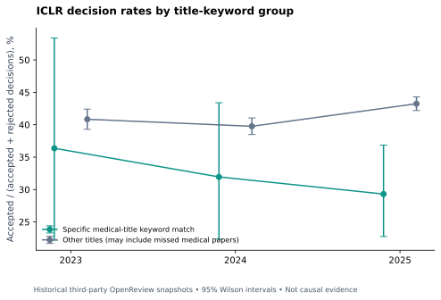

# Medical versus other-title acceptance rates: an ICLR snapshot study

**Scope: ICLR 2023–2025 public submission snapshots. This does not estimate
medical acceptance rates for every conference in the awesome list.** Other
conferences need complete topic-labeled submissions and decisions, not just
accepted proceedings or aggregate conference statistics.

Direct OpenReview note queries returned browser-verification HTML during this
study. For a reproducible, explicitly limited comparison, we used Paper Copilot's
[published dataset](https://github.com/papercopilot/paperlists), pinned to commit
`9fcfd1234879a8e5630b5116dde411ec143dd763`. It is a **third-party historical
snapshot of OpenReview**, not a live official census. Source URLs and response
checksums are in [submission provenance](submission_sources.json). The primary
[OpenReview retrieval documentation](https://docs.openreview.net/how-to-guides/data-retrieval-and-modification/how-to-get-all-notes-for-submissions-reviews-rebuttals-etc)
explains status fields; the import script supports official API v2 when available.

## Consistent topic rule for accepted and rejected papers

Apply the same specific medical title-keyword rule to **all** submissions.
The curated accepted list is not used to label only the accepted side, which
would introduce outcome-dependent classification bias. `medical_keyword`
means a title matched the published rules; `other_titles` means it did not.
The latter can include medical papers missed by keywords and is not a
ground-truth nonmedical group. These estimates are classifier-dependent.

The primary denominator is **accepted + rejected final decisions**. Withdrawn,
desk-rejected, and unknown records are shown separately. Consequently these
rates are **conditional on receiving an accept/reject decision** and generally
exceed chair-reported accepted/submitted rates. The CSV also reports the
accepted fraction of the entire observed pool, including withdrawals and desk
rejections, and a second, broader keyword definition as sensitivity analyses.

| Year | Title group | Accept | Reject | Decision rate | 95% Wilson interval | Withdraw | Desk reject |
|---|---|---|---|---|---|---|---|
| 2023 | medical_keyword | 12 | 21 | 36.36% | 22.19%–53.38% | 14 | 1 |
| 2023 | other_titles | 1563 | 2264 | 40.84% | 39.29%–42.41% | 1063 | 17 |
| 2024 | medical_keyword | 23 | 49 | 31.94% | 22.33%–43.39% | 32 | 0 |
| 2024 | other_titles | 2237 | 3389 | 39.76% | 38.49%–41.05% | 1621 | 53 |
| 2025 | medical_keyword | 46 | 111 | 29.30% | 22.74%–36.84% | 77 | 1 |
| 2025 | other_titles | 3657 | 4800 | 43.24% | 42.19%–44.30% | 2911 | 69 |

## Classification sensitivity

| Year | Rule definition | Medical-keyword decision rate | Other-title decision rate |
|---|---|---|---|
| 2023 | specific_title_proxy | 36.36% | 40.84% |
| 2023 | broad_sensitivity | 28.33% | 41.00% |
| 2024 | specific_title_proxy | 31.94% | 39.76% |
| 2024 | broad_sensitivity | 33.88% | 39.79% |
| 2025 | specific_title_proxy | 29.30% | 43.24% |
| 2025 | broad_sensitivity | 35.98% | 43.19% |

The broader rule changes which titles enter each group. It includes terms such
as brain, biomedical, microscopy, treatment, and survival, which can identify
additional health research but also generic or basic-science work. Neither rule
has a validated precision/recall estimate for rejected papers. The difference
between definitions is part of the result, not a reason to select a preferred
headline after seeing outcomes.

Wilson intervals quantify binomial sampling variability under that model;
they do not account for snapshot selection, missing records, topic-label errors,
or venue policy changes. These historical records are not a random sample from
all future submissions. No significance or causal claim about reviewer preference
is made. Compare within the same year, track, source, rule, and denominator.

## Official whole-conference baselines

| Conference | Year | Track | Submissions | Accepted | Reported-count rate | Primary source |
|---|---|---|---|---|---|---|
| ICLR | 2023 | main | 4938 | 1574 | 31.88% | [source](https://media.iclr.cc/Conferences/ICLR2024/ICLR2024-Fact_Sheet.pdf) |
| ICLR | 2024 | main | 7262 | 2260 | 31.12% | [source](https://media.iclr.cc/Conferences/ICLR2024/ICLR2024-Fact_Sheet.pdf) |
| ICLR | 2025 | main | 11603 | 3704 | 31.92% | [source](https://media.iclr.cc/Conferences/ICLR2025/ICLR2025_Fact_Sheet.pdf) |
| NeurIPS | 2024 | main | 15671 | 4037 | 25.76% | [source](https://media.neurips.cc/Conferences/NeurIPS2024/NeurIPS2024-Fact_Sheet.pdf) |
| NeurIPS | 2025 | main | 21575 | 5290 | 24.52% | [source](https://blog.neurips.cc/2025/09/30/reflections-on-the-2025-review-process-from-the-program-committee-chairs/) |

Official numbers are retained separately rather than silently forcing the
snapshot or proceedings to agree. ICLR 2023's baseline is derived from the
explicit year-on-year count differences in the 2024 fact sheet. The fact sheet
counts and snapshot counts have different inclusion and timing conventions.

## Snapshot validation and other fields

| Year | Snapshot accepts | Exact-title matches to catalog | Catalog records | Unknown status |
|---|---|---|---|---|
| 2023 | 1575 | 1574 | 1584 | 0 |
| 2024 | 2260 | 2260 | 2260 | 0 |
| 2025 | 3703 | 3696 | 3703 | 0 |

The 2023 `Top-5%` and `Top-25%` labels denote accepted presentation tiers; all
371 such titles were checked against the official accepted index before mapping
them to `accepted`. IDs, not titles, deduplicate submissions. Unrecognized
statuses stay unknown and never become implicit rejections. Title changes can
cause catalog validation mismatches; an unmatched title is not reclassified.

Self-reported research-area rates for 2024 and 2025 are available in
[acceptance_by_area.csv](acceptance_by_area.csv). Those categories change across
years and are not a mutually exclusive medical/nonmedical ontology. Missing
2023 areas are explicitly `not_reported`. The headline medical comparison uses
the stable title classifier instead of stitching incompatible area labels.
See [all rate definitions](acceptance_rates.csv),
[paper-level derived labels](submission_annotations.csv), and
[validation counts](submission_validation.csv).

### 2024: ten largest self-reported areas by final-decision count

| Research area | Accept | Reject | Conditional decision rate |
|---|---|---|---|
| representation learning for computer vision, audio, language, and other modalities | 307 | 438 | 41.21% |
| unsupervised, self-supervised, semi-supervised, and supervised representation learning | 218 | 433 | 33.49% |
| generative models | 300 | 296 | 50.34% |
| general machine learning (i.e., none of the above) | 214 | 380 | 36.03% |
| reinforcement learning | 206 | 335 | 38.08% |
| societal considerations including fairness, safety, privacy | 159 | 273 | 36.81% |
| optimization | 95 | 161 | 37.11% |
| transfer learning, meta learning, and lifelong learning | 86 | 169 | 33.73% |
| applications to physical sciences (physics, chemistry, biology, etc.) | 96 | 152 | 38.71% |
| datasets and benchmarks | 89 | 123 | 41.98% |

### 2025: ten largest self-reported areas by final-decision count

| Research area | Accept | Reject | Conditional decision rate |
|---|---|---|---|
| foundation or frontier models, including LLMs | 469 | 545 | 46.25% |
| applications to computer vision, audio, language, and other modalities | 420 | 475 | 46.93% |
| generative models | 377 | 390 | 49.15% |
| alignment, fairness, safety, privacy, and societal considerations | 332 | 432 | 43.46% |
| unsupervised, self-supervised, semi-supervised, and supervised representation learning | 236 | 374 | 38.69% |
| reinforcement learning | 230 | 323 | 41.59% |
| datasets and benchmarks | 228 | 323 | 41.38% |
| applications to physical sciences (physics, chemistry, biology, etc.) | 178 | 245 | 42.08% |
| optimization | 162 | 247 | 39.61% |
| interpretability and explainable AI | 155 | 246 | 38.65% |
