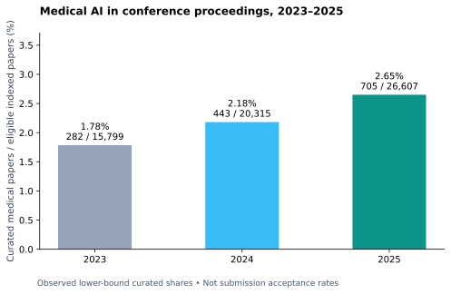
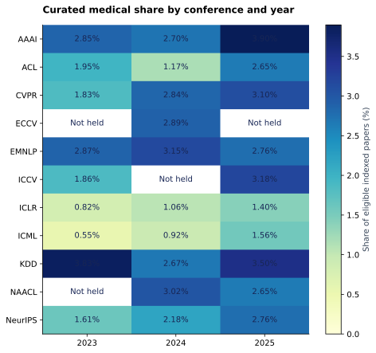

# Medical AI papers as a share of conference proceedings, 2023–2025

The numerator is the curated medical AI list, aligned by exact normalized title,
conference, and publication year. The denominator is the indexed research
catalog for the same edition. These are **observed lower-bound shares of the
indexed corpus**, not complete estimates of every medical paper and not
acceptance rates. A positive trend can reflect curation coverage as well as
changes in published research.

| Year | Curated medical | Eligible indexed papers | Observed medical share |
|---|---|---|---|
| 2023 | 282 | 15799 | 1.78% |
| 2024 | 443 | 20315 | 2.18% |
| 2025 | 705 | 26607 | 2.65% |

## Every indexed conference edition

| Conference | Year | Curated medical | All catalog records | Eligible research | Share of eligible research |
|---|---|---|---|---|---|
| AAAI | 2023 | 49 | 2023 | 1720 | 2.85% |
| AAAI | 2024 | 68 | 2581 | 2517 | 2.70% |
| AAAI | 2025 | 124 | 3239 | 3182 | 3.90% |
| ACL | 2023 | 21 | 1075 | 1075 | 1.95% |
| ACL | 2024 | 11 | 940 | 940 | 1.17% |
| ACL | 2025 | 45 | 1699 | 1699 | 2.65% |
| CVPR | 2023 | 43 | 2353 | 2353 | 1.83% |
| CVPR | 2024 | 77 | 2716 | 2716 | 2.84% |
| CVPR | 2025 | 89 | 2871 | 2871 | 3.10% |
| ECCV | 2024 | 69 | 2387 | 2387 | 2.89% |
| EMNLP | 2023 | 30 | 1047 | 1047 | 2.87% |
| EMNLP | 2024 | 40 | 1268 | 1268 | 3.15% |
| EMNLP | 2025 | 50 | 1809 | 1809 | 2.76% |
| ICCV | 2023 | 40 | 2156 | 2156 | 1.86% |
| ICCV | 2025 | 86 | 2701 | 2701 | 3.18% |
| ICLR | 2023 | 13 | 1584 | 1584 | 0.82% |
| ICLR | 2024 | 24 | 2260 | 2260 | 1.06% |
| ICLR | 2025 | 52 | 3703 | 3703 | 1.40% |
| ICML | 2023 | 10 | 1828 | 1828 | 0.55% |
| ICML | 2024 | 24 | 2610 | 2610 | 0.92% |
| ICML | 2025 | 52 | 3330 | 3330 | 1.56% |
| KDD | 2023 | 19 | 496 | 496 | 3.83% |
| KDD | 2024 | 15 | 562 | 562 | 2.67% |
| KDD | 2025 | 27 | 771 | 771 | 3.50% |
| NAACL | 2024 | 17 | 562 | 562 | 3.02% |
| NAACL | 2025 | 19 | 718 | 718 | 2.65% |
| NeurIPS | 2023 | 57 | 3540 | 3540 | 1.61% |
| NeurIPS | 2024 | 98 | 4493 | 4493 | 2.18% |
| NeurIPS | 2025 | 161 | 5823 | 5823 | 2.76% |

The CSV includes both all-catalog and research-only denominators. For AAAI,
research-only includes technical and special research tracks and the 2024
Intelligent Robots research section; it excludes student/doctoral abstracts,
faculty/senior presentations, journal track, demos, errata, and co-located
IAAI/EAAI. Research, applied-data-science, and datasets/benchmarks remain in KDD;
datasets/benchmarks remain in NeurIPS. Track-level counts are exported separately.
Do not compare a combined-track numerator to a main-track-only denominator.

## Venue-mix sensitivity

ICCV/ECCV alternate and NAACL was not held in 2023. The pooled total consequently
does not have a fixed venue mix. As a sensitivity analysis, combine ICCV/ECCV and
give each family present in all three years equal weight:

| Year | Common families | Equal-weight mean share |
|---|---|---|
| 2023 | 9 | 2.02% |
| 2024 | 9 | 2.18% |
| 2025 | 9 | 2.76% |

Common families: AAAI, ACL, CVPR, EMNLP, ICCV/ECCV, ICLR, ICML, KDD, NeurIPS. This sensitivity controls
family composition, not topic classification error or incomplete curation.

## Coverage and reproducibility

The denominator measures indexed published/accepted-list records, which can
differ from chair-reported accepts because of withdrawals, corrections, track
boundaries, and snapshot timing. See [source coverage](../coverage.md).
Not-held editions are omitted, never treated as zero-percent medical years.
Counts are publication records, not unique research projects; cross-venue
versions are not collapsed. No binomial confidence interval is assigned to
these descriptive census shares: classification and coverage are the main
uncertainties. Download [conference-year counts](conference_year_shares.csv),
[track counts](track_shares.csv), and [provenance](summary.json).
