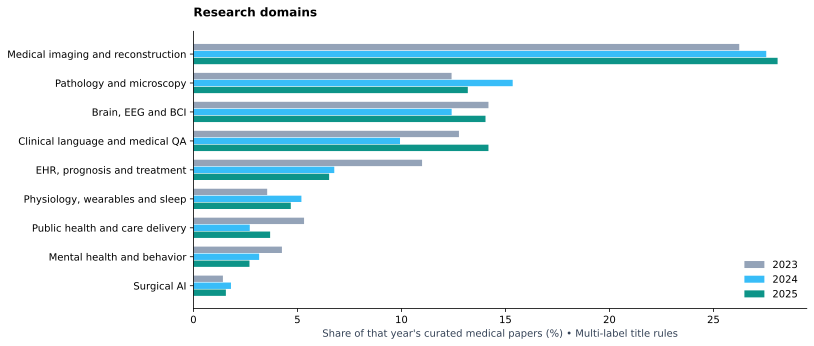
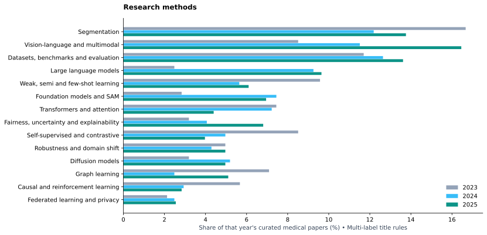

# What medical AI papers studied in 2023–2025

This study analyzes **titles of curated papers**, with publication years from
the proceedings. It uses transparent multi-label domain/method patterns and
document-frequency keywords. Every year uses the same text field and rules;
uneven abstract availability is not allowed to change the text input by year.

Each paper can have several domains and methods, so percentages need not sum
to 100%. A zero means no title matched that rule, not that no work on the topic
was published. Counts reflect this list's scope and curation coverage.

## Label coverage

| Year | Label family | At least one match | No match | Match coverage |
|---|---|---|---|---|
| 2023 | domain | 234 | 48 | 82.98% |
| 2023 | method | 183 | 99 | 64.89% |
| 2024 | domain | 349 | 94 | 78.78% |
| 2024 | method | 295 | 148 | 66.59% |
| 2025 | domain | 570 | 135 | 80.85% |
| 2025 | method | 490 | 215 | 69.50% |

## Research domains

| Topic | 2023 | 2024 | 2025 |
|---|---|---|---|
| Brain, EEG and BCI | 40 (14.18%) | 55 (12.42%) | 99 (14.04%) |
| Clinical language and medical QA | 36 (12.77%) | 44 (9.93%) | 100 (14.18%) |
| EHR, prognosis and treatment | 31 (10.99%) | 30 (6.77%) | 46 (6.52%) |
| Medical imaging and reconstruction | 74 (26.24%) | 122 (27.54%) | 198 (28.09%) |
| Mental health and behavior | 12 (4.26%) | 14 (3.16%) | 19 (2.70%) |
| Pathology and microscopy | 35 (12.41%) | 68 (15.35%) | 93 (13.19%) |
| Physiology, wearables and sleep | 10 (3.55%) | 23 (5.19%) | 33 (4.68%) |
| Public health and care delivery | 15 (5.32%) | 12 (2.71%) | 26 (3.69%) |
| Surgical AI | 4 (1.42%) | 8 (1.81%) | 11 (1.56%) |

## Methods and research approaches

| Topic | 2023 | 2024 | 2025 |
|---|---|---|---|
| Causal and reinforcement learning | 16 (5.67%) | 13 (2.93%) | 20 (2.84%) |
| Datasets, benchmarks and evaluation | 33 (11.70%) | 56 (12.64%) | 96 (13.62%) |
| Diffusion models | 9 (3.19%) | 23 (5.19%) | 35 (4.96%) |
| Fairness, uncertainty and explainability | 9 (3.19%) | 18 (4.06%) | 48 (6.81%) |
| Federated learning and privacy | 6 (2.13%) | 11 (2.48%) | 18 (2.55%) |
| Foundation models and SAM | 8 (2.84%) | 33 (7.45%) | 49 (6.95%) |
| Graph learning | 20 (7.09%) | 11 (2.48%) | 36 (5.11%) |
| Large language models | 7 (2.48%) | 41 (9.26%) | 68 (9.65%) |
| Robustness and domain shift | 14 (4.96%) | 19 (4.29%) | 35 (4.96%) |
| Segmentation | 47 (16.67%) | 54 (12.19%) | 97 (13.76%) |
| Self-supervised and contrastive | 24 (8.51%) | 22 (4.97%) | 28 (3.97%) |
| Transformers and attention | 21 (7.45%) | 32 (7.22%) | 31 (4.40%) |
| Vision-language and multimodal | 24 (8.51%) | 51 (11.51%) | 116 (16.45%) |
| Weak, semi and few-shot learning | 27 (9.57%) | 25 (5.64%) | 43 (6.10%) |

## Title keyword analysis

Lowercase titles, split hyphens, tokenize alphabetic/alphanumeric words, remove
the published stopword list, and count unigrams and adjacent non-stopword
bigrams once per paper. `large`, `model`, and `models` remain available inside
bigrams (for example, `large language` and `foundation models`) while remaining
unigram stopwords. No stemming or learned topic model is used. Terms with
fewer than five papers over the full period are omitted from the keyword CSV.
Generic list-wide terms such as `medical`, `learning`, and `segmentation` are
stopwords for exploratory keywords; segmentation remains a separate method.
Keyword extraction is exploratory and sensitive to naming conventions.

### 2023

| Keyword / phrase | Papers | Share of that year's curated medical papers |
|---|---|---|
| language | 23 | 8.16% |
| brain | 21 | 7.45% |
| detection | 19 | 6.74% |
| transformer | 16 | 5.67% |
| health | 15 | 5.32% |
| whole | 15 | 5.32% |
| graph | 14 | 4.96% |
| knowledge | 14 | 4.96% |
| self | 14 | 4.96% |
| slide | 14 | 4.96% |
| whole slide | 14 | 4.96% |
| domain | 12 | 4.26% |
| semi | 12 | 4.26% |
| diagnosis | 11 | 3.90% |
| report | 11 | 3.90% |

### 2024

| Keyword / phrase | Papers | Share of that year's curated medical papers |
|---|---|---|
| language | 51 | 11.51% |
| brain | 28 | 6.32% |
| language models | 28 | 6.32% |
| health | 24 | 5.42% |
| large language | 24 | 5.42% |
| detection | 23 | 5.19% |
| multimodal | 22 | 4.97% |
| slide | 22 | 4.97% |
| diffusion | 21 | 4.74% |
| domain | 21 | 4.74% |
| reconstruction | 21 | 4.74% |
| scale | 19 | 4.29% |
| vision | 19 | 4.29% |
| whole | 19 | 4.29% |
| whole slide | 19 | 4.29% |

### 2025

| Keyword / phrase | Papers | Share of that year's curated medical papers |
|---|---|---|
| language | 83 | 11.77% |
| brain | 61 | 8.65% |
| multimodal | 57 | 8.09% |
| vision | 50 | 7.09% |
| aware | 42 | 5.96% |
| language models | 37 | 5.25% |
| knowledge | 35 | 4.96% |
| vision language | 35 | 4.96% |
| diffusion | 32 | 4.54% |
| foundation | 32 | 4.54% |
| visual | 32 | 4.54% |
| whole | 32 | 4.54% |
| slide | 31 | 4.40% |
| diagnosis | 30 | 4.26% |
| graph | 30 | 4.26% |

## Largest increases in title frequency, 2023 → 2025

| Keyword / phrase | 2023 papers | 2025 papers | 2023 share | 2025 share | Change (percentage points) |
|---|---|---|---|---|---|
| multimodal | 10 | 57 | 3.55% | 8.09% | +4.54 |
| foundation | 2 | 32 | 0.71% | 4.54% | +3.83 |
| language | 23 | 83 | 8.16% | 11.77% | +3.62 |
| reasoning | 1 | 28 | 0.35% | 3.97% | +3.62 |
| vision | 10 | 50 | 3.55% | 7.09% | +3.55 |
| language models | 5 | 37 | 1.77% | 5.25% | +3.48 |
| decoding | 1 | 26 | 0.35% | 3.69% | +3.33 |
| vision language | 5 | 35 | 1.77% | 4.96% | +3.19 |
| llm | 0 | 21 | 0.00% | 2.98% | +2.98 |
| visual | 5 | 32 | 1.77% | 4.54% | +2.77 |
| llms | 1 | 22 | 0.35% | 3.12% | +2.77 |
| pathology | 3 | 27 | 1.06% | 3.83% | +2.77 |
| aware | 9 | 42 | 3.19% | 5.96% | +2.77 |
| guided | 5 | 30 | 1.77% | 4.26% | +2.48 |
| large language | 3 | 25 | 1.06% | 3.55% | +2.48 |
| foundation model | 0 | 16 | 0.00% | 2.27% | +2.27 |
| alignment | 5 | 28 | 1.77% | 3.97% | +2.20 |
| disease | 5 | 28 | 1.77% | 3.97% | +2.20 |
| language model | 1 | 17 | 0.35% | 2.41% | +2.06 |
| agent | 0 | 14 | 0.00% | 1.99% | +1.99 |

This ranking requires at least eight papers across the two endpoint years and
at least five in 2025. It compares normalized shares, not just raw count growth.
Overlapping unigrams and bigrams are retained, so `language` and `language
models` can appear together; they are not independent signals.

## Interpretation and limits

Inspect domain trends and method trends separately: a paper can study pathology
using a vision-language foundation model. Domain and method growth are not
competing slices of one pie. Changes across three observed years do not establish
a long-run trend, clinical effectiveness, or a causal response to model releases.
The curated corpus does not cover all health research, specialist medical
conferences, or every broad candidate in the index. Quantitative topic assignments
use deterministic matching rules; corpus membership follows the repository's
recorded curation decisions, whose scope errors can propagate into this study.

Download [paper-level labels](medical_papers.csv), [topic counts](topic_trends.csv),
[yearly keywords](keywords_by_year.csv), and [normalized keyword changes](keyword_changes.csv).
